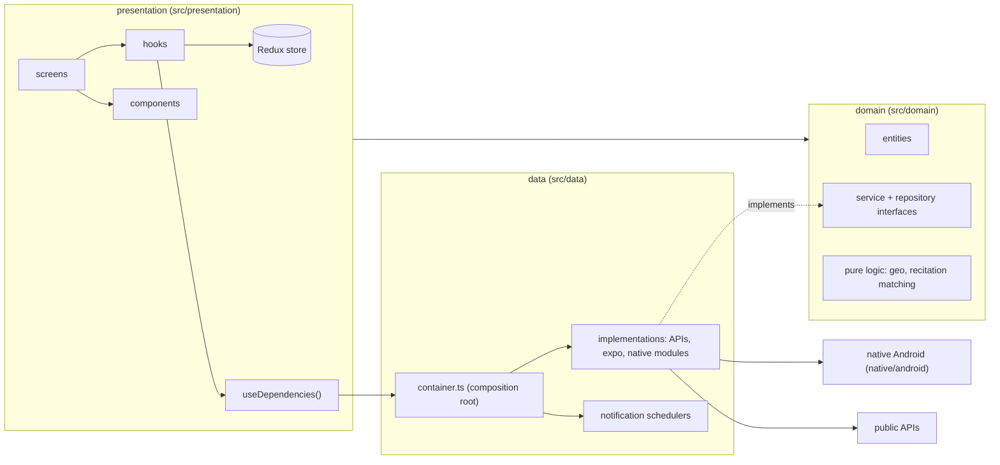
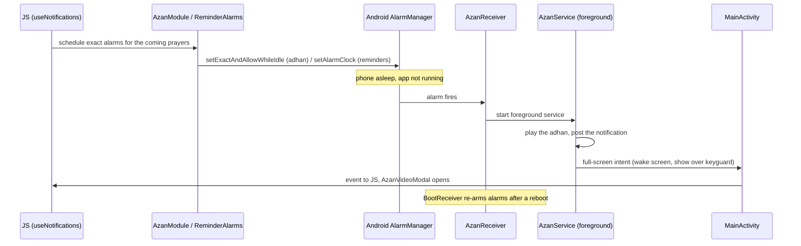

# Owwab — system architecture

How the app is built and how its parts talk to each other. For the folder layout see [STRUCTURE.md](STRUCTURE.md); for what each feature does see [features/](features/README.md); for the product view see [PRD.md](PRD.md).

- **Stack:** React Native 0.81.5, Expo SDK 54, React 19, TypeScript (strict), New Architecture (bridgeless).
- **Platform:** Android only. There is an `ios/` folder, but it is a stale leftover and is not built.
- **Backend:** none. The app has no server of its own and no user accounts. It calls a few public APIs and keeps everything else on the phone.

## 1. Layers

Dependencies point inward only: `presentation → domain ← data`.

| Layer | Folder | Holds | May import |
|---|---|---|---|
| domain | `src/domain/` | entities, pure logic, and the interfaces for anything with side effects | `domain`, `shared` only |
| data | `src/data/` | classes that implement those interfaces (HTTP, AsyncStorage, expo modules, native modules) | `domain`, `shared` |
| presentation | `src/presentation/` | screens, components, hooks, Redux store, navigation | `domain`, `shared`, and `data` only through `useDependencies()` |

The rules are written in `CLAUDE.md` at the repo root. Older code still breaks them in places: some hooks and screens import `src/data` directly (tasmee, reminders, `ayahSearch`, `hadithLibrary`). Issue #24 tracks moving them behind the container.

### Composition root

`src/data/container.ts` is the only place that picks concrete classes. `src/presentation/providers/DependencyProvider.tsx` hands the result to React, and code reads it with `useDependencies()`. The same object is exported as `appDependencies` for code that runs outside React (startup).

| Key | Interface (domain) | Implementation (data) |
|---|---|---|
| `quran` | `QuranRepository` | `QuranApiRepository` |
| `tafsir` | `TafsirRepository` | `QuranComTafsirRepository` |
| `hadith` | `HadithRepository` | `HadeethEncRepository` |
| `floatingSebha` | `FloatingSebha` | `NativeFloatingSebha` |
| `prayerWidget` | `PrayerWidget` | `NativePrayerWidget` |
| `azanAlarms` | `AzanAlarms` | `NativeAzanAlarms` |
| `location` | `LocationProvider` | `ExpoLocationProvider` |
| `quranPlayer`, `azanSound` | `QuranPlayer`, `AzanSound` | one shared `ExpoAudioPlayer` |
| `notifications` | `NotificationCenter` | `ExpoNotificationCenter` with six schedulers |
| `mosques` | `MosqueFinder` | `OsmMosqueFinder` |

Adding a reminder kind means adding one scheduler to the list passed to `ExpoNotificationCenter`; the center itself does not change.

## 2. Startup

1. `index.ts` forces RTL (`I18nManager.forceRTL`), registers the root component, and registers the TrackPlayer playback service (`src/data/services/TrackPlayerService.ts`).
2. `App.tsx` keeps the native splash up while fonts load (Tajawal and Amiri, with an 8-second safety timeout), then shows `AnimatedSplash`.
3. Providers wrap the tree: Redux `Provider` and `PersistGate`, React Query's `QueryClientProvider`, `SafeAreaProvider`, the theme root, and an error boundary.
4. `Bootstrapper` runs `useNotifications()` (which reschedules every notification and alarm) and resets the daily athkar state, and mounts three global overlays above the navigator: `AzanVideoModal`, `ReminderAlarm`, and `FloatingTasbeehController`.

There is no onboarding flow. See [features/about-privacy-splash.md](features/about-privacy-splash.md).

## 3. State

Redux Toolkit with redux-persist on AsyncStorage (`src/presentation/store/index.ts`).

- Persist key `root_v6`, version 6.
- 13 slices: `settings`, `quran`, `duas`, `athkar`, `achievements`, `ibada`, `stats`, `tasbeeh`, `ui`, `prayer`, `audio`, `favorites`, `reminders`.
- `ui` and `audio` are **not** persisted. They are session state: an open adhan screen or a "playing" flag must not come back after the app is killed.
- `achievements` is registered but nothing reads or writes it.
- `@tanstack/react-query` is installed and its provider is mounted; only `src/presentation/hooks/useQuran.ts` uses it.

Some services keep their own AsyncStorage caches outside Redux (hadith details, mosque results). Each feature doc lists its keys.

## 4. Navigation

`src/presentation/navigation/AppNavigation.tsx`: one stack navigator whose first screen is a bottom-tab navigator.

- **Tabs** (stable ids, Arabic titles): `TabHome` الرئيسية, `TabPrayer` الصلاة, `TabQuran` القرآن, `TabTasbeeh` المسبحة, `TabAthkar` الأذكار. The Quran tab hides the tab bar. The bar itself is `GlassTabBar.tsx`.
- **Stack routes** keep Arabic names, used directly in `navigate()` calls: الأدعية, نور_القلب, الختمات, الفضائل, رسائل_القرآن, الأحاديث, الحديث, الخصوصية, عن_التطبيق, القبلة, الزكاة, العبادات, الإعدادات, الإحصائيات, التذكيرات, التسميع, المساجد.
- Two stack routes, الأذكار and الصلاة, are declared but no `navigate()` call reaches them; those screens are only shown as tabs.
- Param types live in `src/presentation/navigation/types.ts`.
- The navigation state is kept in a module variable so that switching the theme, which remounts the tree, leaves the user where they were.
- `navigationRef` is exported for code outside the navigator (the reminder alarm opening the mushaf).

Known problem: the active tab expands and pushes the other tabs sideways (#17).

## 5. Theme

Files in `src/shared/theme/`.

- `tokens.ts` holds a `dark` and a `light` palette. `colors` is an object of getters, so a read always returns the active palette. `themed(() => ({...}))` builds one stylesheet per theme. `night` is the dark palette for screens that are always dark (art screens).
- `ThemeRoot.tsx` applies the mode (فاتح / داكن / حسب الموبايل), remounts the navigation tree on change, and sets the native root background with `expo-system-ui`.
- `useAccent.ts` returns the accent chosen in settings (ذهبي, زمردي, ليلي).
- NativeWind is configured (`tailwind.config.js`, `global.css`), but the design system is the tokens file plus the primitives in `src/presentation/components/ui/`.

Known gap: many components read `colors.gold*` directly instead of `useAccent()`, so a non-gold accent is applied only in part (#6). Details in [features/settings-theme.md](features/settings-theme.md).

## 6. Audio

There are two players, and they do not share state. This is the cause of #5.

| Use | Player | File | Notification / lock-screen controls |
|---|---|---|---|
| One ayah, or a page (sequence of ayat) | expo-av `Sound` | `src/data/services/AudioService.ts` | No |
| A full surah | react-native-track-player | `src/data/services/TrackPlayerService.ts` | Yes |
| In-app adhan sound | expo-av (same `ExpoAudioPlayer` instance) | `src/data/services/AudioService.ts` | No |
| Adhan and reminder alarms when the app is closed | Android `MediaPlayer` in native code | `native/android/java/AzanService.java` | Own notification |

`src/presentation/hooks/useAudio.ts` computes `isPlaying` from TrackPlayer's playback state only. Ayah and page playback run through expo-av, so `isPlaying` stays false while they play, the play button never turns into a stop button, and a second tap restarts the page. See [features/quran-audio.md](features/quran-audio.md).

## 7. Notifications and alarms

Two mechanisms, chosen by how exact the timing must be.

- **expo-notifications**, through `ExpoNotificationCenter` (`src/data/notifications/`). Six schedulers: `PrayerScheduler`, `AthkarScheduler`, `SpiritualScheduler`, `DailyWardScheduler`, `EncouragementScheduler`, `CustomReminderScheduler`. Everything is rescheduled when the app opens (`rescheduleAll` in `src/presentation/hooks/useNotifications.ts`). There is no background fetch or TaskManager job.
- **Native exact alarms** for the adhan and for reminders in "alarm" style, so they fire in Doze, with the screen locked and the app killed.

The exact order of calls inside the native classes is described in [features/adhan.md](features/adhan.md). `OemBatteryModule` opens the battery-saver screens of Xiaomi and similar phones, and `AzanReadinessCard` shows which permissions are still missing.

## 8. Native Android

`android/` is git-ignored and regenerated by `npx expo prebuild`. Hand-written native code lives in `native/android/` and is injected at prebuild.

| Piece | Files | Role |
|---|---|---|
| Adhan and reminders | `native/android/java/AzanModule.java`, `AzanReceiver.java`, `AzanService.java`, `BootReceiver.java`, `ReminderAlarms.java`, `AzanPackage.java` | exact alarms, foreground playback, full-screen launch, re-arming after boot |
| Battery helpers | `native/android/java/OemBatteryModule.java`, `OemBatteryPackage.java` | open OEM battery-optimisation settings |
| Home-screen widget | `native/android/java/widget/` (`PrayerWidgetProvider.kt`, `PrayerWidgetModule.kt`, `PrayerWidgetPackage.kt`, `WidgetSky.kt`) and `native/android/res/` | prayer countdown widget |
| Injection | `plugins/withOwwabNative.js` | copies sources and resources, adds services and receivers to the manifest, registers the packages in `MainApplication`, patches `MainActivity` for the adhan intent, sets a dark window background, writes R8 keep rules |
| Floating tasbeeh | `plugins/withFloatingBubble.js`, the vendored `react-native-floating-bubble-1.0.12.tgz`, `patches/` | overlay bubble service |

Three rules that have already caused production bugs:

- **Bridgeless:** `reactInstanceManager.currentReactContext` is always null. Use `(application as ReactApplication).reactHost?.currentReactContext`.
- **R8 shrinking:** release builds strip resources and classes that are only referenced by name. `native/android/res/raw/owwab_keep.xml` keeps the sound files; the keep rules in `plugins/withOwwabNative.js` keep `expo.modules.notifications.**`, Serializable members, ONNX Runtime, the audio stream and the player classes. The rules block is rewritten on every prebuild.
- **patch-package:** three patches in `patches/` are applied on `npm install` (floating bubble, track player, PCM audio stream).

## 9. External services

No analytics, crash reporting or ads SDK is in `package.json`.

| Host | Used for | Code | What is sent |
|---|---|---|---|
| `api.alquran.cloud` | Quran page and surah data | `src/data/api/clients.ts`, `QuranApiRepository` | page or surah numbers |
| `api.quran.com` | tafsir text | `src/data/api/clients.ts`, `QuranComTafsirRepository` | tafsir id and ayah key |
| `hadeethenc.com` | hadith details | `src/data/api/clients.ts`, `HadeethEncRepository` | hadith id, language |
| `api.aladhan.com` | prayer times | `src/data/api/clients.ts`, `AladhanPrayerTimes` | coordinates, date, calculation method |
| `everyayah.com`, `server*.mp3quran.net` | recitation audio | `AudioService`, `CustomReminderScheduler` | reciter, surah and ayah in the URL |
| `audio.qurancdn.com` | word-by-word audio in tasmee | `src/data/services/wordAudio.ts` | word position in the URL |
| GitHub releases | download of the speech model for tasmee (157 MB) | `src/data/services/RecitationListener.ts` | nothing beyond the request |
| `owwab.vercel.app/api/mosques`, `nominatim.openstreetmap.org` | nearby mosques | `src/data/services/MosqueService.ts`, `landing/api/mosques.js` | position rounded to about 100 m |
| `owwab.vercel.app` | landing site and APK download; link from the about screen | `landing/` | — |

Per-feature details, including what the privacy screen promises, are in the feature docs. Microphone audio in tasmee is processed on the device.

## 10. Bundled data

All content ships as TypeScript modules, not JSON files or a database.

| Data | File | Size |
|---|---|---|
| Quran plain text (search and recitation matching) | `src/data/quran/quranPlainText.ts` | about 0.8 MB |
| Hadith index | `src/data/hadith/hadithIndex.ts` | about 2.4 MB |
| Athkar | `src/shared/constants/athkar.ts` | — |
| Quran messages, virtues, wird plan, hadiths | `src/domain/entities/` | — |
| Adhan, takbir and salawat sounds | `assets/audio/` | — |

## 11. Permissions

Declared in `app.json`. Storage and media-read permissions are explicitly blocked.

| Permission | Needed by |
|---|---|
| `SCHEDULE_EXACT_ALARM`, `USE_EXACT_ALARM` | adhan and alarm-style reminders at the exact minute |
| `USE_FULL_SCREEN_INTENT` | adhan and alarm screens over the lock screen |
| `RECEIVE_BOOT_COMPLETED` | re-arming alarms after a reboot |
| `WAKE_LOCK`, `VIBRATE` | waking the phone for the adhan; haptics |
| `FOREGROUND_SERVICE`, `FOREGROUND_SERVICE_MEDIA_PLAYBACK`, `FOREGROUND_SERVICE_SPECIAL_USE` | adhan playback service, recitation playback, floating tasbeeh |
| `REQUEST_IGNORE_BATTERY_OPTIMIZATIONS` | keeping alarms alive on aggressive phones |
| `SYSTEM_ALERT_WINDOW` | floating tasbeeh; opening the adhan screen from the background |
| `POST_NOTIFICATIONS` | all notifications |
| `RECORD_AUDIO` | tasmee |
| Location (requested at runtime by expo-location) | prayer times, qibla, nearest mosque |

## 12. Build and release

| Step | Command |
|---|---|
| Regenerate `android/` after changing `app.json`, plugins or native code | `npx expo prebuild --platform android --no-install` |
| Release APK for a phone (arm64), installed over USB | `npm run apk:phone` |
| Release APK for the emulator (x86_64) | `npm run apk:emu` |
| Type check (the only automated check) | `npx tsc --noEmit -p .` |

- `scripts/apk.js` runs `gradlew app:assembleRelease` for one ABI and installs with adb. An arm64 build does not start on the x86_64 emulator, and the reverse.
- The emulator build needs about 4 GB of free memory; running the emulator at the same time can make the native compile fail.
- `eas.json` defines `development`, `preview` (APK) and `production` (app bundle) profiles. The app is not on Google Play.
- **Distribution:** the APK is copied to `landing/owwab.apk` and the `landing/` folder is deployed to Vercel (`npx vercel --prod --yes` from `landing/`), served at `owwab.vercel.app`.
- Version is `1.0.0` in `app.json`; `runtimeVersion` follows the app version. `expo-updates` is installed; whether over-the-air updates are in use was not verified.

## 13. Quality

- No unit or UI tests, no Jest config, no ESLint config.
- TypeScript strict mode and `npx tsc --noEmit -p .` are the only gate.
- `scripts/check-message-verses.js` is a one-off check of the Quran-messages data.
- RTL layout cannot be checked in a web preview; it has to be checked on an emulator or phone.

## 14. Known architectural debt

| Item | Where | Issue |
|---|---|---|
| Two audio players with separate state | `useAudio.ts`, `AudioService.ts`, `TrackPlayerService.ts` | #5, #15 |
| Fixed gold used instead of the accent | across `src/presentation` | #6 |
| Presentation importing `src/data` directly | older hooks and screens | #24 |
| Unused code | `achievementsSlice`, `src/presentation/components/prayer/PrayerTimesComponents.tsx`, `MUEZZINS` in `AzanConstants.ts` | — |
| Settings that nothing reads | `locationEnabled`, `notificationPrefs.dailyReminder`, `calculationMethod` | — |
| `themed()` caches per light/dark only, so accent-dependent styles cannot live in it | `src/shared/theme/tokens.ts` | #6 |
| Privacy screen behind the code | `src/presentation/screens/PrivacyScreen.tsx` | — |
| No automated tests | whole repo | — |
